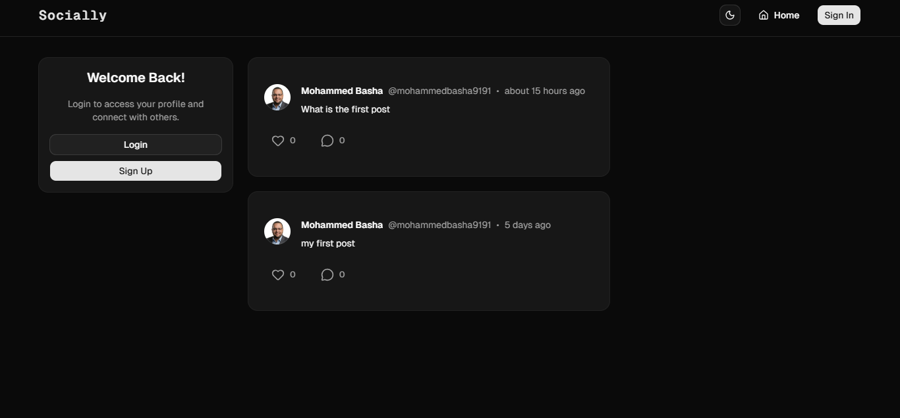

# Social Media App

A modern, full-stack social media application built with **Next.js, React, and TypeScript**, featuring authentication, posts, image uploads, likes, comments, notifications, user profiles, and more.

The project focuses on building a complete web application while exploring modern Next.js development patterns, server-side operations, database integration, and responsive UI design.

## 📸 Screenshots

### Homepage – Dark Mode



## ✨ Features

### 🔐 Authentication

- User authentication powered by Clerk.
- Sign up and sign in using Google.
- Email and password authentication.
- Email verification with a 6-digit verification code.
- User authentication and database synchronization.

### 📝 Posts & Interactions

- Create posts with text and images.
- Upload images using UploadThing.
- Like and interact with posts.
- Comment on posts.
- Delete posts.

### 👤 User Profiles

- Individual user profile pages.
- View user posts and profile information.
- Update profile information.
- Follow and interact with other users.

### 🔔 Notifications

- Notifications for user interactions.
- Dedicated notifications page.

### 👥 Social Discovery

- Suggested users to follow.
- User discovery and profile navigation.

### 🎨 UI & User Experience

- Responsive design for desktop and mobile.
- Dark and light themes.
- Reusable UI components.
- Skeleton loading states.
- Interactive dialogs and notifications.

---

## 🛠️ Tech Stack

| Technology                                    | Purpose                            |
| --------------------------------------------- | ---------------------------------- |
| [Next.js 16](https://nextjs.org/)             | Full-stack React framework         |
| [React 19](https://react.dev/)                | User interface                     |
| [TypeScript](https://www.typescriptlang.org/) | Type safety                        |
| [Tailwind CSS 4](https://tailwindcss.com/)    | Styling                            |
| [Shadcn UI](https://ui.shadcn.com/)           | UI components                      |
| [Clerk](https://clerk.com/)                   | Authentication and user management |
| [PostgreSQL](https://www.postgresql.org/)     | Relational database                |
| [Neon](https://neon.com/)                     | Serverless PostgreSQL              |
| [Prisma](https://www.prisma.io/)              | Database ORM                       |
| [UploadThing](https://uploadthing.com/)       | File and image uploads             |
| [Lucide React](https://lucide.dev/)           | Icons                              |
| [Vercel](https://vercel.com/)                 | Deployment                         |

---

## 🏗️ Project Structure

The application follows a modular structure that separates application routes, server actions, reusable components, and shared utilities.

```text
src/
├── actions/
│   ├── notification.action.ts
│   ├── post.action.ts
│   ├── profile.action.ts
│   └── user.action.ts
│
├── app/
│   ├── api/
│   │   ├── tasks/
│   │   └── uploadthing/
│   ├── notifications/
│   ├── profile/
│   │   └── [username]/
│   ├── tasks/
│   ├── globals.css
│   ├── layout.tsx
│   └── page.tsx
│
├── components/
│   ├── ui/
│   ├── CreatePost.tsx
│   ├── PostCard.tsx
│   ├── FollowButton.tsx
│   ├── ImageUpload.tsx
│   ├── Sidebar.tsx
│   ├── Navbar.tsx
│   ├── WhoToFollow.tsx
│   └── ThemeProvider.tsx
│
├── lib/
│   ├── prisma.ts
│   ├── uploadthing.ts
│   └── utils.ts
│
└── proxy.ts
```

---

## 🚀 Getting Started

Follow these steps to run the project locally.

### Prerequisites

Make sure you have the following installed:

- Node.js
- npm
- A Clerk account
- A Neon PostgreSQL database
- An UploadThing account

### 1. Clone the repository

```bash
git clone YOUR_GITHUB_REPOSITORY_URL

cd social-app
```

### 2. Install dependencies

```bash
npm install
```

### 3. Configure environment variables

Create a `.env` file in the project root and configure the credentials for your services.

```env
# Database
DATABASE_URL="your_neon_database_connection_string"

# Clerk Authentication
NEXT_PUBLIC_CLERK_PUBLISHABLE_KEY="your_clerk_publishable_key"
CLERK_SECRET_KEY="your_clerk_secret_key"

# UploadThing
UPLOADTHING_TOKEN="your_uploadthing_token"
```

Make sure to configure any additional environment variables required by your Prisma configuration and deployment setup.

### 4. Generate Prisma Client

```bash
npx prisma generate
```

Run database migrations if your project has migration files:

```bash
npx prisma migrate dev
```

### 5. Start the development server

```bash
npm run dev
```

Open [http://localhost:3000](http://localhost:3000) in your browser.

---

## 🧠 What I'm Exploring

This project is also an opportunity to strengthen my understanding of modern full-stack development, particularly:

- Next.js App Router and file-based routing.
- Server Components vs. Client Components.
- Server Actions and API Routes.
- Authentication and user synchronization.
- Database relationships and queries with Prisma.
- TypeScript in full-stack applications.
- Image uploads and third-party integrations.
- Responsive UI architecture and reusable components.
- Application performance and optimization.

---

## 📌 Project Status

<kbd>In Development</kbd>

The core social media functionality is being implemented, with ongoing improvements, testing, and additional features planned.

---

## 👨‍💻 Author

**Mohammed Basha**

Full-Stack Web Developer | React | Next.js | TypeScript | Node.js | Magento

- GitHub: [MohammedBasha](https://github.com/MohammedBasha)
- LinkedIn: [Connect with me](https://www.linkedin.com/in/mohammed-basha)

---

_Built with curiosity, continuous learning, and a passion for creating modern web applications._
